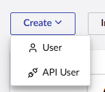
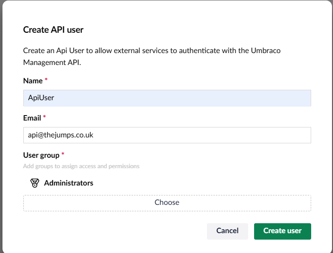
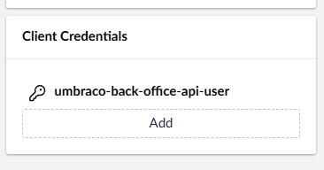

# uSync Command Line library

### uSync command line for Umbraco v15+

This is the v15+ version of the uSync command line util, it uses the ManagementAPI (and the uSync Management API) to do the funky stuff without
you having to install anything on the server.

```
dotnet tool install uSync.Cli
```

## Loads of useful commands for Umbraco !

In this beta, we have plugged in the 'useful' things you might need from the command line.

rebuild indexes, models or caches, or run usync imports or exports.

```
uSync CommandLine: 17.0.0

Description:

Usage:
  uSync [command] [options]

Options:
  --version       Show version information
  -?, -h, --help  Show help and usage information

Commands:
  test                     Test command
  config-check             Show the server, client id and secret in use and where each came from, then check they sign in
  files-verify             Check the uSync folder for problems (merge conflicts, clashes, broken files). Offline, no server needed.
  files-diff               List the uSync items added, changed or deleted since a git ref. Offline, needs git.
  files-find               Find the uSync files for an item by key, alias or file name. Offline, no server needed.
  files-clean              List uSync's delete markers with their age, and remove old ones with --remove. Offline.
  user-current             Fetch the user executing the commands
  user-list                List all users
  content-urls             Check every published document has a working url (no collisions, no unpublished parents). Exits 1 on problems.
  recyclebin-list          List what is in the content and media recycle bins
  cache-rebuild            Rebuild the cache on the server
  cache-reload             Reload the cache on the server
  cache-status             Show whether the cache is being rebuilt on the server
  models-rebuild           Rebuild the models on the server
  models-status            Get the status of the models on the server
  server-troubleshoot      Show the site's troubleshooting information (versions, OS, database), for support issues
  redirects-list           Show whether redirect tracking is on, and list the redirects
  webhook-list             List the webhooks on the server
  indexer-rebuild          Rebuild the index on the server
  indexer-list             List the indexes on the server, with their health and document counts
  healthcheck-list         List the health checks on the server
  healthcheck-group-list   List the health check groups on the server
  healthcheck-group-check  Run a health check on the server
  healthcheck-run-all      Run every health check group on the server
  server-status            Show the site's runtime level and Umbraco version. Exits 1 unless the site is running.
  package-migrations       List the packages with pending migrations, and run them with --run
  log-errors               List errors logged on the site recently. Exits 1 if there are any.
  usync-settings           List all settings
  usync-import             Import all items
  usync-export             Export all items
  usync-ping               Wait for the site to answer (e.g. after a deploy)
  usync-report             Report what an import would change (dry run)
```

e.g

run an import

```
uSyncCli usync-import -s https://myserver.com/ --force
```

## Create an API user

In the users section of Umbraco



create the api user and add them to the relevant group



## Add a Client Secret and Key

Once you have created an API user , you will need to give them a client id and secret,



you will need both the client id and secret to connect via the command line.

## either add an appsetting.json or use the `-k` `-i` settings

you can add an appsettings.json to the root of the folder where
you are running the uSync command line:

```json
{
  "uSync": {
    "Command": {
      "Secret": "[CLIENT_SECRET]",
      "ClientId": "[CLIENT_ID]"
    }
  }
}
```

or you can pass these on the command line. eg.

```
uSyncCli usync-ping -s https://localhost:44359 -k [client_secret] -i [client_id]
```

or set them as environment variables, which keeps the secret off the command line (and out of build logs):

| Variable | Same as |
|---|---|
| `USYNC_SERVER` | `-s` / `--server-url` |
| `USYNC_CLIENT_ID` | `-i` / `--client-id` |
| `USYNC_CLIENT_SECRET` | `-k` / `--secret` |

The command line wins, then the environment variables, then appsettings.json.

`config-check` shows which server, client id and secret the commands will use and where each one came from
(an option, an environment variable, appsettings.json or launchSettings.json), then signs in and says which
API user it is. It never prints the secret, only its length. It exits 2 if something isn't set, and 1 if the
site rejects the credentials.

```
uSyncCli config-check
```

## JSON output (`--json`)

`user-list`, `user-current`, `healthcheck-list`, `healthcheck-group-list`, `models-status` and `usync-settings`
take `--json` to write the result as JSON instead of text, for scripts (`jq`, `ConvertFrom-Json`). The
version banner goes to stderr, so stdout is only the JSON.

```powershell
uSyncCli user-list --json | ConvertFrom-Json | Select-Object -ExpandProperty items
```

## Checking the uSync files (`files-verify`)

`files-verify` checks the uSync folder in your repo without a site, database or keys, so it can run
on every pull request (or in a pre-commit hook) and stop bad files before they reach a server.

```
uSyncCli files-verify
```

It finds the uSync folder the same way the site does: `uSync:Settings:Folders` (the last one) or
`uSync:Settings:RootFolder` from `appsettings.json`, else the highest `uSync/v{n}` folder. It looks in the
current folder and site folders up to three levels below it. Use `--folder` to point at it.

**Errors** (exit 1):

| Id | Check |
|---|---|
| USYNC001 | Merge conflict markers (`<<<<<<<`, `=======`, `>>>>>>>`, `\|\|\|\|\|\|\|`) in any file. Found in the raw text, because markers inside a CDATA block (block list JSON, rich text) still parse as valid XML and would be imported as they are. |
| USYNC002 | A `.config` file that isn't valid XML. |
| USYNC003 | Two files of the same type with the same `Key`. |
| USYNC004 | Two items of the same type with the same `Alias` and different `Key`s - e.g. two branches that each added an `article` doc type. Not checked for content and media, where the alias is the node name. |
| USYNC005 | An `<Empty Change="Delete">` file and a live item with the same `Key`. |

**Warnings** (exit 0, unless `--warnings-as-errors`):

| Id | Check |
|---|---|
| USYNC101 | A composition, parent, data type, list view, template, parent template or allowed child that no file in the folder defines. Often fine (it's already on the site), but can mean a file is missing from the commit. |
| USYNC102 | `usync.config` was written by an older major version of uSync than the one in the site's `.csproj` (or `Directory.Packages.props`). Run a full export. |
| USYNC103 | Unknown folders, or files that aren't `.config` files. Folders whose files are uSync items (custom handlers) are fine. |
| USYNC104 | Content, blueprints or media whose content / media type has no file (only with `--content`). |
| | |
| USYNC201 | (error) `--publish-folder` output is missing the uSync folder, or files in it are missing or different. |

Options:

| Option | |
|---|---|
| `--folder <path>` | The uSync folder, if it can't be found. |
| `--content` | Also check `Content`, `Media` and `Blueprints`. Off by default, as content folders can be big. |
| `--format text\|github\|sarif\|junit` | Default `github` when `GITHUB_ACTIONS=true`, else `text`. `github` writes annotations that show on the pull request. `sarif` (2.1.0) is for GitHub code scanning and Azure DevOps, `junit` shows as test results in Azure DevOps and GitLab. |
| `--output <file>` | Write `sarif` / `junit` to a file (the problems are still listed in the log). Without it they go to stdout. |
| `--warnings-as-errors` | Warnings fail the run too. |
| `--changed-since <ref>` | Only report problems in files changed since the ref (`git diff <ref>...HEAD`, plus uncommitted and untracked files). Every file is still loaded, so a clash between a new file and an existing one is found. Needs the ref's history - in GitHub Actions use `fetch-depth: 0`. |
| `--summary` | Write a markdown summary to `$GITHUB_STEP_SUMMARY` (or the console when it isn't set). With `--changed-since` it lists each item the branch adds, changes or deletes. |
| `--publish-folder <path>` | Check a publish output contains the uSync folder with the same files. Forgetting to copy it is a common deploy mistake, and the only symptom is that nothing imports. |

Exit codes: `0` clean, `1` errors (or warnings with `--warnings-as-errors`), `2` the tool itself failed
(folder not found, bad arguments, git failed).

e.g. on a pull request:

```
uSyncCli files-verify --changed-since origin/main --summary
```

## More offline file commands (`files-diff`, `files-find`, `files-clean`)

These work on the uSync folder in your repo, like `files-verify`, and take `--folder` the same way.

`files-diff <ref>` lists the uSync items a branch adds, changes or deletes since the ref (plus uncommitted
changes): the same list `files-verify --changed-since <ref> --summary` writes, without running the checks.
`--format text|json|markdown` (default `text`).

```
uSyncCli files-diff origin/main --format json
```

`files-find <key-or-alias>` lists the files that hold an item, by key, alias (any case) or file name, including
content and media. Handy when `files-verify` reports a clash (USYNC003, USYNC004). Exits 1 if nothing matches.

`files-clean` lists uSync's delete markers (`<Empty Change="Delete">` files) with how long ago each was last
committed. A marker is how uSync tells other sites to delete an item, so it has to stay until every site has
imported it. Once that's certain, `--older-than <days> --remove` deletes the markers committed more than that
many days ago (uncommitted ones are never removed). Commit the result like any other change.

## Waiting for a site (`usync-ping`)

After a deploy, `usync-ping` waits until the site hands out an access token:

```
uSyncCli usync-ping --timeout 300
```

It tries every few seconds until `--timeout` (seconds, default 300) runs out, then exits 1 with "the site
never came up". If the site answers but refuses the client id or secret, it stops straight away.
`--retrys` also limits the number of attempts.

## Checking a deploy (`server-status`, `package-migrations`, `log-errors`)

`usync-ping` says the site answers. These say whether it is in a fit state:

```
uSyncCli server-status
uSyncCli package-migrations --run
uSyncCli usync-import
uSyncCli log-errors --since 15m
```

- `server-status` shows the runtime level (`Run`, `Upgrade`, `BootFailed`...), the Umbraco version and the
  runtime mode. It exits 1 unless the site is at `Run`. The status itself doesn't need a token, so it still
  says why when the site is waiting for an upgrade and the API user can't sign in.
- `package-migrations` lists packages with pending migrations. `--run` runs them (exit 1 if any fail),
  `--fail-on-pending` exits 1 if there are any instead.
- `log-errors` lists what the site logged at `--level` (`Warning`, `Error` (default) or `Fatal`) or worse,
  since `--since` (`90s`, `15m` (default), `2h`, `1d`, or a date). It exits 1 if it finds any, so it works as a
  smoke test after an import; `--no-fail` turns that off. `--take` sets how many are listed (default 20).
  It reads Umbraco's log viewer, so it sees the logs of the server that answers the request.

`cache-rebuild --wait` waits until the rebuild has finished (`--timeout`, default 600 seconds), and
`cache-status` shows whether one is running.

## Letting the site say it's up (`files-webhook`, `uSync.Command.Notify`)

Instead of a pipeline waiting with `usync-ping`, the site can tell it when a new build has started.
Add the `uSync.Command.Notify` package to the site. It adds a "uSync Site Started" webhook event that fires
once per new build, with a GitHub `repository_dispatch` shaped payload.

`files-webhook` writes the webhook into your uSync folder, so it goes out with your other settings:

```
uSyncCli files-webhook --repo my-org/my-site
```

The file only names the token (a `uSync-Notify-Token: GitHubToken` header). Set the token itself on the site as
`uSync__Notify__Secrets__GitHubToken`. The package adds it as the `Authorization` header when the webhook sends,
and only to hosts in `uSync:Notify:AllowedHosts` (default `api.github.com`).

`--url` sends somewhere other than GitHub, `--token-name` changes or (empty) drops the token header,
`--folder` picks the uSync folder.

The full setup, with the GitHub workflows that use it, is in
[usync-actions: docs/deploy-callback.md](https://github.com/Jumoo/usync-actions/blob/main/docs/deploy-callback.md).

## Reporting changes (`usync-report`)

`usync-report` is a dry run of an import: it lists what would change on the site, without changing anything.
Takes the same `--set` and `--group` options as `usync-import`. It exits `0` even when there are changes, and `1`
only if the report itself fails.

```
uSyncCli usync-report --set Default
```

## Health checks

`healthcheck-group-check --group uSync` exits 1 when any result is an error, so a pipeline can run the
uSync folder checks on a deployed site.

`healthcheck-run-all` runs every group. It exits 1 on any error, or with `--fail-on warning` on warnings too
(`--fail-on none` never fails). `--quiet` lists only the warnings and errors.

## Errors and exit codes

Errors print as one `ERROR: ...` line. Commands exit `2` when they are used wrongly or not configured
(a missing option, no server or credentials, a client id that doesn't start with `umbraco-back-office`)
and `1` when something fails at run time (the site rejected the credentials, an HTTP error).
Set `USYNC_DEBUG=1` to see the full stack trace.

## Diagnostics

- `server-troubleshoot` prints the site's troubleshooting information (Umbraco and .NET versions, OS, database,
  runtime mode...), the same as the backoffice's Information dashboard. `--markdown` writes it as a table to
  paste into an issue.
- `redirects-list` says whether redirect tracking is on and lists the redirects (`--filter` on the original url,
  `--take`, default 100).
- `webhook-list` lists the webhooks with their url and events, e.g. to check the one `files-webhook` wrote was
  imported. Header values can be secrets, so it only shows header names.
- `indexer-list` shows each index's health and document count. `--fail-unhealthy` exits 1 if any index isn't
  healthy.

## GitHub step summary

When `$GITHUB_STEP_SUMMARY` is set (it is in GitHub Actions), `usync-import` and `usync-report` add a
markdown table of the changes to the job summary, and `files-verify --summary` adds its results.

## Content checks (`content-urls`, `recyclebin-list`)

`content-urls` walks the content tree and checks every published document has a url in each culture it is
published in. Umbraco works out the problems (a url that collides with another page, an unpublished parent,
no hostname for a non-default language), and the command lists them and exits 1. Run it after a content
import to catch pages nobody can reach.

```
uSyncCli content-urls
```

`recyclebin-list` lists what is in the content and media recycle bins (`--take`, default 50), e.g. before an
import that deletes items. `--empty --yes` empties both bins. That permanently deletes the items, so
`--empty` on its own refuses to run.

## Imports and exports

`usync-import` and `usync-export` run one handler per request and print each handler as it completes.
If a step fails, the command says which handler failed and why, and exits with a non-zero code, so
build pipelines can spot a run that stopped part way. A run where any item fails to import also
exits non-zero.

Without `--set`, the site's default handler set is used. Set names are case sensitive (`--set Default`).

Each request has a 30 minute timeout. To change it, add `Timeout` to the appsettings.json:

```json
{
  "uSync": {
    "Command": {
      "Timeout": "01:00:00"
    }
  }
}
```

### Background processing

If the site has uSync's `ProcessingMode` set to `Background` (uSync 17.4.0 or later), the server runs the
whole import or export as one background job. The command polls the server for progress, prints each
handler as it finishes, and exits with the same results and exit codes as a normal run.

Each poll is a short request, so the timeout above doesn't limit how long the whole run takes. It's
used as the longest the command will wait for the next handler to finish before deciding the run has
stalled. Stopping the command doesn't stop the run on the server.

## Automagic Server discovery. 
if you place the uSync:Command settings in the appsettings.json file of a site. then if you run the uSync command 
from within the site directory it will attempt to workout the server Url, 

if will check : 
  1. the command line `-s` parameter
  2. for a `uSync:Command:ServerUrl` value in appsettings
  3. for the UmbracoApplicationUrl value `Umbraco:CMS:WebRouting:UmbracoApplicationUrl`
  4. for the applicationUrl value in the `Properties\launchSettings.json` file.

if it finds one, it will use it as the server address. 

## Automagic Api User / ClientID & Secret Generation.

if the settings are stored in the sites appsettings.json (or the enviroment or a key vault). then you can
use the `uSync.Command.Setup` package to automatically setup the API user for you. 

```json
"uSync": {
    "Command": {
      "AddIfMissing": true,
      "ClientId": "[CLIENT_ID]",
      "Secret": "[CLIENT_SECRET]"
    }
  }
```

on boot the `uSync.Command.Setup` package will check to see if the clientId has been setup on your site.
if it hasn't it creates an API user with the clientId / secret. 

you can also specify `Email`, `Username` and `Name` for the API account, but if you don't some will
be generated for you. 

> [!WARNING]
> This isn't compuslary, and it does open you up to potential issues if someone gets access to your appsettings.json
> (although you might already be in trouble if this happens). 


